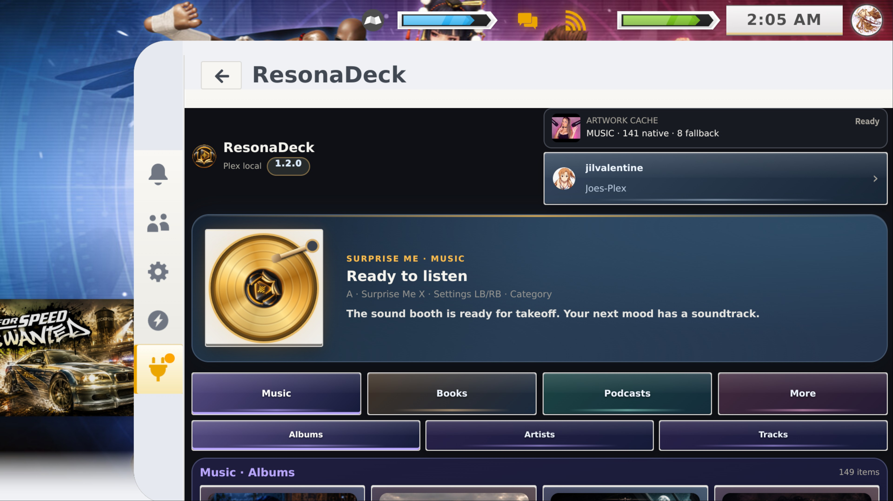
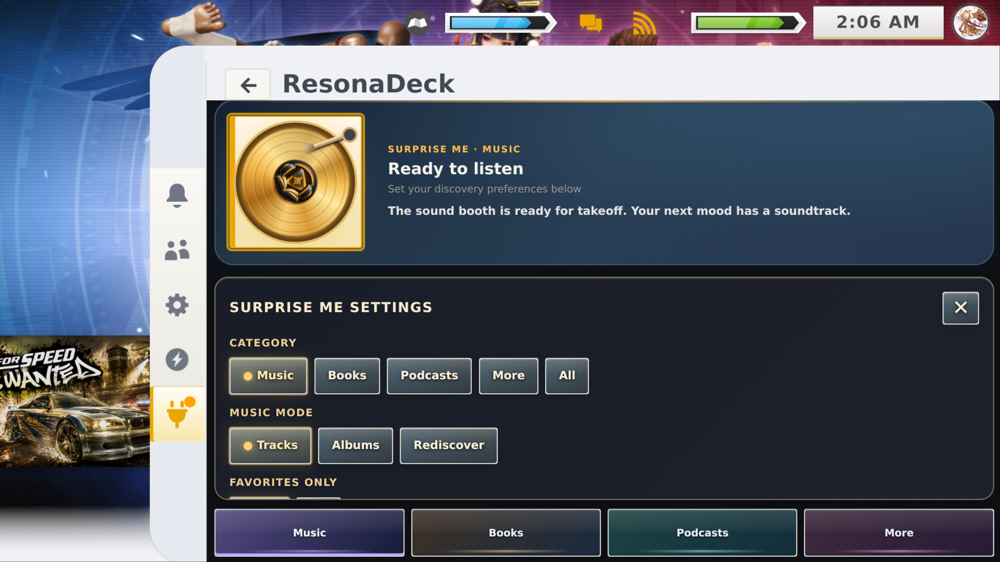
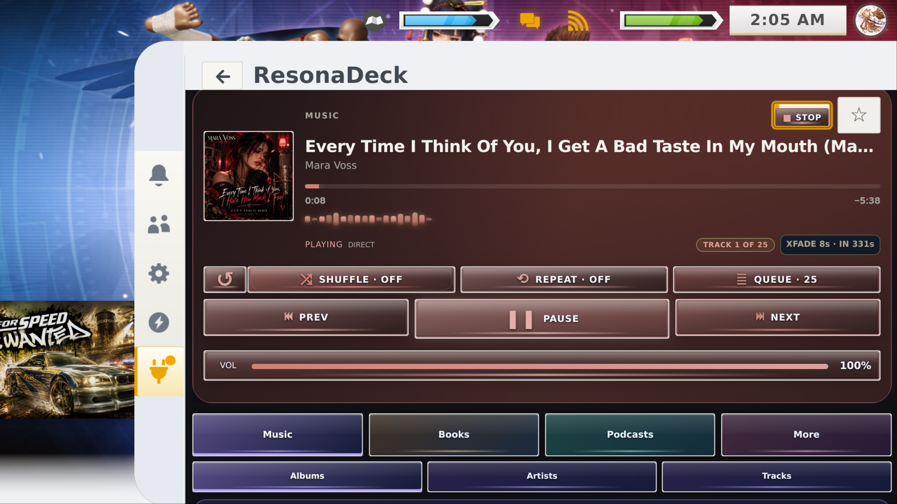
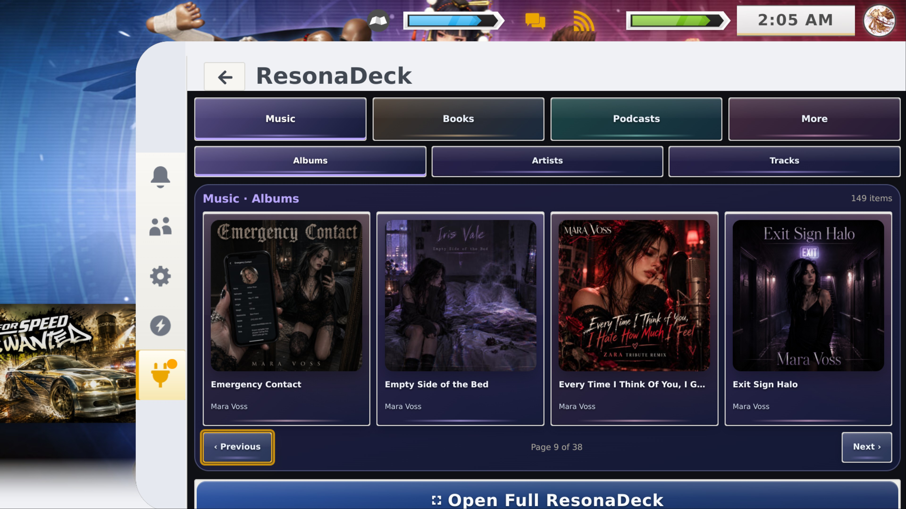

# 🎧 ResonaDeck
### Your Plex audio library, right where you play.

**Premium, controller-first Plex audio for Steam Deck.**  
Music · Audiobooks · Podcasts · More Audio

*Artwork-colored playback controls, directly in your Quick Access Menu.*

**[Download v1.2.1 Stable](https://github.com/ValentineBSAA/ResonaDeck/releases/tag/1.2.1) · [View all screenshots](SCREENSHOTS.md) · [Share feedback](https://github.com/ValentineBSAA/ResonaDeck/discussions/3) · [Report a problem](https://github.com/ValentineBSAA/ResonaDeck/issues)**

---

## 🎵 What is ResonaDeck?

**ResonaDeck** is a Decky Loader plugin that brings **your own Plex audio libraries** into Steam Deck's **Quick Access Menu** and a larger **Full Manager**. Browse covers, play music while gaming, pick up an audiobook, or manage a queue without switching to a separate music application.

It's designed around the Steam Deck controller, with colorful frosted-glass controls that follow the artwork you're listening to.

## ✨ Highlights

| | |
| :--- | :--- |
| **Surprise Me discovery** | Generate themed listening sessions across Plex music and other audio libraries, with Favorites-only options. |
| **Keep Playing** | Automatic music queue refill, repeat protection, and optional 30-minute, 1-hour, or 2-hour listening sessions. |
| **Automatic music crossfade** | Dual-stream overlap with Off, 3, 5, 8, and 10-second choices. Automatic **8-second fades are Steam Deck-confirmed**. |
| **Vinyl record transition** | Incoming record arrives beside the cover, transitions through the gold turntable, and expands into full-square album art. |
| **Favorites and listening tools** | Favorites browser, saved sessions, local playlists, sleep timer, and artwork prefetch/fallbacks. |
| **Live XFADE feedback** | Countdown, preparation, fade progress, completion, and error/blocker states. |
| **Quick Menu player** | Play and control your audio while using Steam and games. |
| **Artwork-colored glass** | Player buttons, queue, and visual accents adapt to the current cover art. |
| **Four library identities** | Music in blue-violet, Audiobooks in slate/copper, Podcasts in teal, and More Audio in plum. |
| **Full ResonaDeck** | Home shelves, Music, Audiobooks, Podcasts, More Audio, Search, and library management. |
| **Queue that works with a controller** | Add to Queue, Play Next, total track count, queue drawer, and remove actions. |
| **Long-form listening** | Audiobook chapters, resume, podcast browsing, and relevant playback controls. |
| **Designed for Steam themes** | Glass control layers that resist white-background CSS Loader overrides. |

## 🆕 What's new in 1.2.1 Stable

**Easier updates, same working player.** This release adds official GitHub repository metadata so [Decky Direct Updater](https://deckyup.nukeador.com/) can identify ResonaDeck and offer future published GitHub updates. The compatible ZIP remains a complete plugin installation.

**Nothing about your music playback has been redesigned.** The eight-second automatic crossfade, Surprise Me, Keep Playing, Favorites, vinyl-to-cover animation and controller actions are carried forward from creator-tested 1.2.0 Stable.

**[1.2.1 release notes](RELEASE_NOTES_1.2.1.md) · [Current verification status](FEATURE_STATUS_1.2.1.md) · [Previous 1.2.0 feature release](RELEASE_NOTES_1.2.0.md)**

Direct Updater is an optional independent Decky plugin. It requires confirmation before installing an update. The complete 1.2.1 update path on Steam Deck still needs hardware acceptance testing.

## 📸 See ResonaDeck in action

### New in 1.2.0 · Surprise Me and active playback

<table>
<tr>
<td align="center" width="50%"> <b>Surprise Me</b> Choose the gold record. A starts listening; X opens or closes settings.</td>
<td align="center" width="50%"> <b>Surprise Me Settings</b> Choose discovery mode, favorites, session length, and music crossfade.</td>
</tr>
<tr>
<td align="center" width="50%"> <b>Now Playing + XFADE</b> Live crossfade countdown and queue controls in the Quick Menu.</td>
<td align="center" width="50%"> <b>Music albums</b> Still familiar: album browsing keeps its controller-first layout.</td>
</tr>
</table>

**[Explore all 13 screenshots: 1.2.0 new features + 1.0.0 preserved interface →](SCREENSHOTS.md)**

The nine original screenshots remain intentionally in the gallery. Most library browsing, Full Manager, audiobook and search screens have not undergone major redesigns; the 1.2.0 changes primarily expand listening and playback.

## 🚀 Install or update

**You'll need:** A Steam Deck with [Decky Loader](https://github.com/SteamDeckHomebrew/decky-loader) and access to your Plex Media Server with audio libraries. ResonaDeck does not bundle copyrighted media.

### Option A: Decky Direct Updater (optional)

1. Install [Decky Direct Updater](https://deckyup.nukeador.com/) on your Steam Deck.
2. Open its search icon (beside Refresh) and enter **`ValentineBSAA/ResonaDeck`**.
3. Select the official repository, then **Install** or **Update**, and confirm the Decky prompt.
4. If your existing 1.2.0 plugin asks you to confirm a GitHub source, select **`ValentineBSAA/ResonaDeck`**. Version 1.2.1 includes this association in its metadata to assist future updates.

Direct Updater is separate from ResonaDeck and does **not** silently install updates. Real Steam Deck updater installation has not yet been independently confirmed.

### Option B: Manual ZIP (always supported)

1. Download **[ResonaDeck-1.2.1-Stable.zip](https://github.com/ValentineBSAA/ResonaDeck/releases/download/1.2.1/ResonaDeck-1.2.1-Stable.zip)**.
2. Open Decky **Settings → General**, enable **Developer Mode**, then go to **Developer → Install Plugin from ZIP**.
3. Select the entire ZIP, confirm the installation, and open ResonaDeck to authorize Plex and choose your libraries.

This ZIP is the **full plugin, not a patch**. Back up important settings before trying a new update method. [Troubleshooting guide](SUPPORT.md).

## 🎲 Surprise Me · Quick start

1. Open ResonaDeck in the Steam Deck Quick Access Menu and locate the **gold Surprise Me turntable**.
2. Focus the turntable. Press **X** for **Surprise Me Settings**, choosing your category, music mode (**Tracks, Albums, Rediscover**), and Favorites-only preference.
3. Choose a track count or a timed session (**30 minutes, 1 hour or 2 hours**); select **Keep Playing** for continuously replenished music.
4. For music, choose a **crossfade** setting (Off, 3, 5, 8 or 10 seconds). The automatic **8-second overlap** was tested on a real Steam Deck.
5. Press **A** on Surprise Me to start listening. Once music starts, focus the **playing album cover** and press **X** to reopen or close the same settings without stopping the music.

**X depends on what is focused.** On ordinary Albums / Artists / Tracks it still opens the familiar media actions menu, including **Add to Queue**, **Play Next**, and **Browse Details**. The new Surprise Me behavior does not replace those older controls.

## 🔄 What Changed Between 1.0.0 and 1.2.0?

| Introduced or substantially expanded in 1.2.0 | Kept from the established 1.0.0 experience |
| :--- | :--- |
| Surprise Me discovery, selectable gold turntable, themed settings | Music/Books/Podcasts/More categories and controller-first library browsing |
| Tracks, Albums, Rediscover, Favorites-only discovery | Album art cards, queues, search and the Full Manager |
| Keep Playing, refill-before-end, timed sessions, Favorites browser | Standard media actions: X → Add to Queue, Play Next, Browse Details |
| Automatic music crossfade, XFADE countdown and diagnostic status | Artwork-reactive glass, library colors, and existing playback buttons |
| Incoming vinyl → gold turntable → full-cover animated transition | Audiobook chapters/resume and podcast library navigation |
| Refined artwork loading/fallback, personal listening tools | The original idle gold turntable and white backing |

**Why older screenshots remain:** these longstanding screens still represent current functionality. We photographed the four new 1.2.0 views where the features visibly changed, rather than replacing accurate screenshots just to change their version label. [See the two release galleries](SCREENSHOTS.md).

## 🎮 Controller guide

| Button | Action |
| :--- | :--- |
| **A** | Play or resume |
| **Hold A** | Preview supported media |
| **X** | On Surprise Me turntable / active cover: open or close discovery settings. On a library item: open its normal media actions. |
| **D-pad ← / →** | Move across action menu columns |
| **D-pad ↑ / ↓** | Move between action menu rows |
| **B** | Back / close the menu or queue |
| **LB / RB** | Switch Full Manager sections |

**Where is search?** Search lives in **Full ResonaDeck**. Quick Menu search was intentionally removed to keep controller navigation smooth.

## 🔊 Two listening experiences

**Quick Access Menu:** Compact playback with artwork-reactive glass, an animated Shuffle highlight, the track queue, volume, and album/artist navigation.

**Full Manager:** A more spacious Plex audio library with shelves, artwork, track details, search, audiobook chapters, player settings, and library tools.

## 🧩 Open source and package integrity

Browse the [frontend source](src/index.js), [installed frontend bundle](dist/index.js), [Plex backend](resonadeck_backend.py), [Decky entrypoint](main.py), [tests](tests/), and [assets](assets/). Version metadata and the displayed version were synchronized with the published 1.2.1 package. **The audio, artwork and controller logic was not changed for this maintenance release.**

See [Source & Integrity](SOURCE.md) for the official ZIP's SHA-256 checksum, verification limits, and historical 1.2.0 source provenance.

## ℹ️ Verification and compatibility

**Creator-confirmed on Steam Deck in 1.2.0:** Surprise Me, Keep Playing, Favorites, the automatic eight-second crossfade, the animated vinyl handoff, and contextual controller actions.

**1.2.1 verified offline:** ZIP structure, release and metadata identities, and preservation of the functioning playback implementation. An actual Direct Updater install or update on Steam Deck still needs testing. Other crossfade durations, unusual codecs/networks and third-party themes need additional coverage. [Detailed checklist](FEATURE_STATUS_1.2.1.md).

## 💬 Share your experience or report a problem

**Already installed ResonaDeck 1.2.1? We'd love to hear how it went.** Whether Surprise Me picked the right songs, crossfade worked on your Plex setup, or you just want to say hello, you can leave a note in the **[1.2.0 release discussion](https://github.com/ValentineBSAA/ResonaDeck/discussions/3)**. Short impressions and questions are welcome. You don't need to write a full bug report.

If something actually breaks, use **[GitHub Issues](https://github.com/ValentineBSAA/ResonaDeck/issues)** so it's easier to reproduce and track. Include SteamOS, Decky, and Plex server details where helpful, but **never post Plex tokens, passwords, or private server links**.

**[Latest release](https://github.com/ValentineBSAA/ResonaDeck/releases/latest)** · **[Full screenshot gallery](SCREENSHOTS.md)** · **[1.2.1 Release Notes](RELEASE_NOTES_1.2.1.md)** · **[Support](SUPPORT.md)** · **[Source & Integrity](SOURCE.md)** · **[Credits and Third-Party Notices](THIRD-PARTY-NOTICES.md)**

---

Created by **Valentine** · **[GPL-3.0](https://www.gnu.org/licenses/gpl-3.0.en.html)**

*Independent project, not affiliated with Plex, Valve, Steam, or Decky Loader.*

